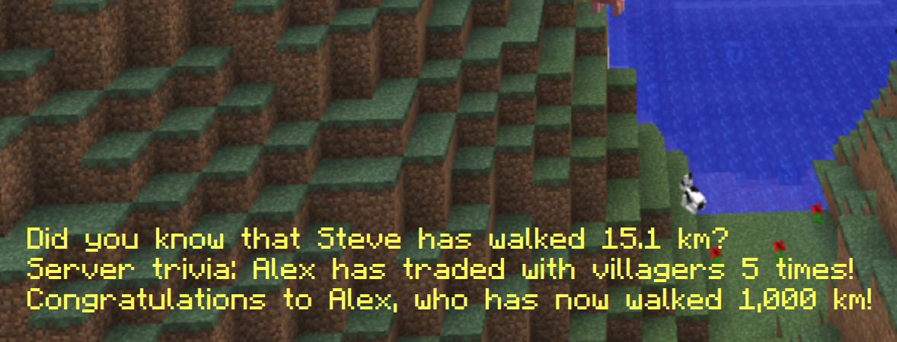

<h1 align="center">StatFacts</h1>

<p align="center">Random player stat facts and milestones for Paper 26.3 servers.</p>

<p align="center">
  
  
  
</p>

<p align="center">
  
</p>

## Commands

Operators only (`statfacts.admin`).

| Command | What it does |
|---|---|
| `/statfacts status` | Show settings, milestone rungs and player counts |
| `/statfacts announce` | Announce one fact now |
| `/statfacts set <key> <value>` | Change a setting |
| `/statfacts stat <id> on\|off` | Turn one stat on or off, with its milestones |
| `/statfacts stats` | List the stats that are off |
| `/statfacts exclude <player> add\|remove` | Keep a player out of announcements |
| `/statfacts reload` | Re-read `config.yml` |

**Settings:** `enabled`, `interval`, `min-players`, `multi-chance`, `include-offline`, `milestones`, `milestone-seconds`.

Edit `config.yml` by hand first. Commands rewrite it and drop its comments.

## Milestones

A milestone fires when a stat crosses a rung in its ladder. The top rung says "Incredible!".

| Ladder | Default rungs |
|---|---|
| `km` | 100, 1,000, 10,000 |
| `count` | 1,000, 10,000, 100,000 |
| `hours` | 100, 1,000 |
| `hearts` | 1,000, 10,000 |

Rungs are set in `config.yml`. A player's first check records the current tier silently, so old milestones don't flood chat.

## Tests

Needs a stats folder with at least two players, such as a copy of a server's `players/stats`. Don't commit player data.

```bash
./build.sh
GSON=$(find ~/.gradle/caches -name 'gson-2.14.0.jar' | head -n1)
mkdir -p build/test
java -m jdk.compiler/com.sun.tools.javac.Main -cp build/classes:$GSON -d build/test src/test/java/statfacts/SelfTest.java
java -cp build/classes:$GSON:build/test statfacts.SelfTest path/to/players/stats
```

## License

[MIT](LICENSE) © willbara
